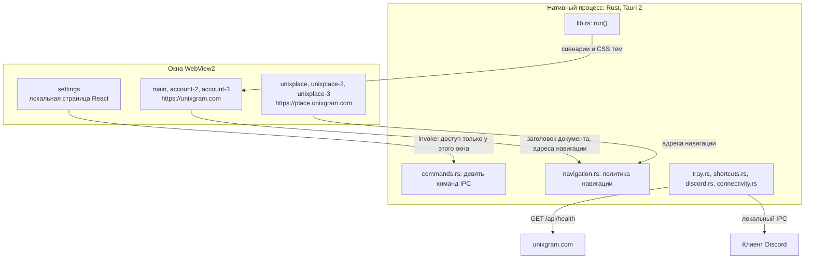
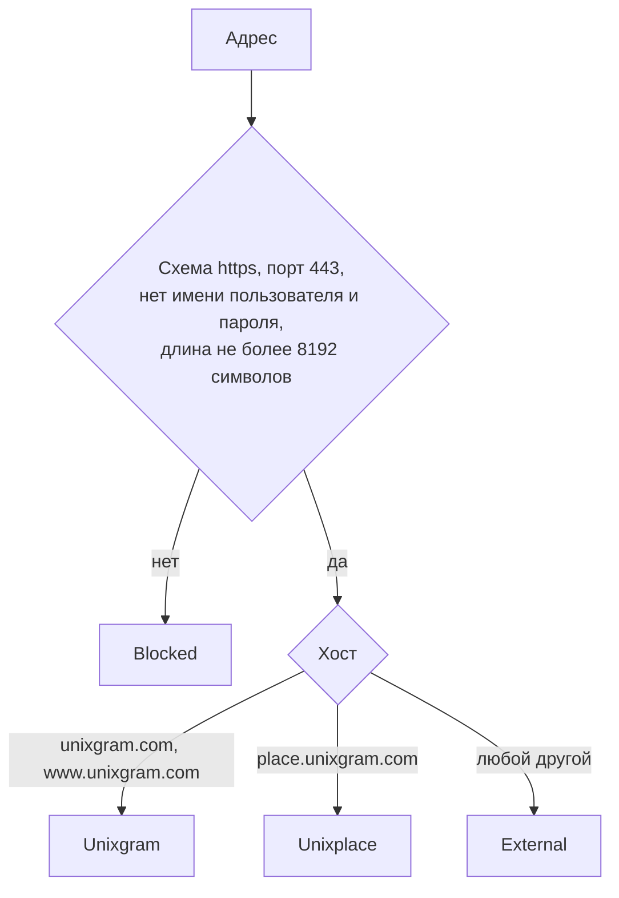
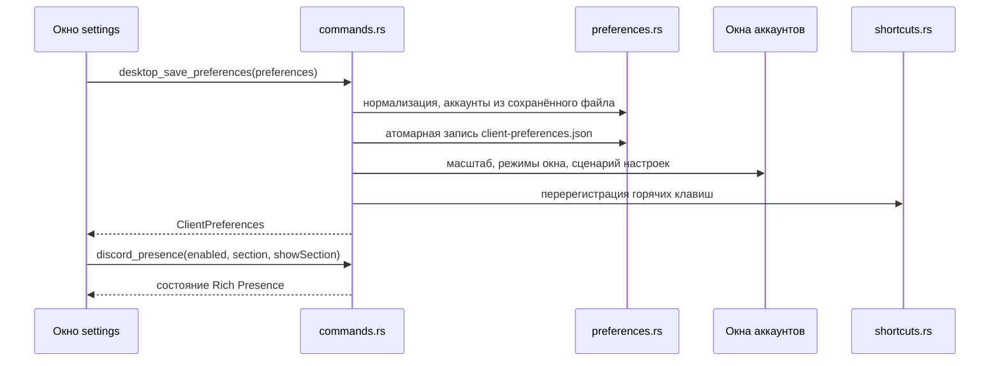

# Архитектура UnixGram Desktop

> [!NOTE]
> UnixGram Desktop — неофициальный клиент сообщества. Проект не связан с командой UnixGram и не одобрен ею.

[Обзор](#обзор) · [Процесс и окна](#процесс-и-окна) · [Модули Rust](#модули-rust) · [Контракт IPC](#контракт-ipc) · [Политика навигации](#политика-навигации) · [Сценарии и граница](#внедряемые-сценарии-и-нативная-граница) · [Настройки](#хранение-настроек) · [Аккаунты](#изоляция-аккаунтов) · [Службы](#системные-службы) · [Темы](#темы) · [Интерфейс настроек](#интерфейс-настроек) · [Тестирование](#тестирование) · [Структура](#структура-репозитория)

## Обзор

Оболочка на Tauri 2 для Windows. Процесс на Rust открывает `https://unixgram.com` и торговую площадку `https://place.unixgram.com` в окнах WebView2 и добавляет значок в трее со счётчиком непрочитанных чатов, темы, до трёх аккаунтов, глобальные горячие клавиши, Discord Rich Presence, контроль соединения и политику навигации.

Свой интерфейс у приложения один: окно настроек, локальная страница на React из установщика. Вход, ленту, сообщения, звонки, платежи и подарки выполняет код сайта внутри WebView2.

## Процесс и окна

Нативный процесс один. Второй запуск показывает окно активного аккаунта (плагин `tauri-plugin-single-instance`).



| Метка | Слот | Содержимое | Каталог данных WebView2 | Исходный размер | Закрытие |
| --- | --- | --- | --- | --- | --- |
| `main` | 1 | `https://unixgram.com/dashboard` | профиль по умолчанию | 1520 × 960 | скрывается в трей |
| `account-2`, `account-3` | 2, 3 | `https://unixgram.com/dashboard` | `account-profiles/account-N` | 1520 × 960 | скрывается в трей |
| `unixplace` | 1 | `https://place.unixgram.com` | профиль по умолчанию | 1320 × 860 | скрывается, показывается окно аккаунта |
| `unixplace-2`, `unixplace-3` | 2, 3 | `https://place.unixgram.com` | `account-profiles/account-N` | 1320 × 860 | скрывается, показывается окно аккаунта |
| `settings` | — | `index.html` из состава приложения | профиль по умолчанию | 760 × 720 | закрывается |

- Исходный размер уменьшается до рабочей области основного монитора с учётом масштаба Windows. Минимальный размер окна — 360 × 320.
- Окна аккаунтов и UnixPlace отправляют User-Agent, совместимый с Microsoft Edge, с суффиксом `UnixGramHistory/<версия>`.
- В окнах аккаунтов отключён обработчик перетаскивания Tauri: перетаскивание файлов обрабатывает сайт.
- После закрытия окна аккаунта процесс остаётся в трее. Завершает его пункт «Выйти» в меню трея.
- Порядок запуска в `run()`: загрузка и нормализация настроек; окно `main` (видимо, если активен аккаунт 1); значок в трее и меню; применение настроек к окнам аккаунтов; регистрация горячих клавиш, если они включены; монитор соединения; показ окна активного аккаунта, если это аккаунт 2 или 3; цикл обновления Discord Rich Presence.

## Модули Rust

| Модуль в `src-tauri/src/` | Ответственность |
| --- | --- |
| `main.rs` | Точка входа. Вызывает `run()`. |
| `lib.rs` | Дерево модулей и `run()`: сборка приложения, плагины, `setup`, обработчики событий, `invoke_handler`. |
| `config.rs` | Константы: базовые адреса, доверенные хосты, User-Agent, идентификатор приложения Discord, адрес профиля автора, пределы (например, не более трёх аккаунтов). |
| `state.rs` | `AppState` и структуры состояния времени выполнения. |
| `preferences.rs` | Модели `ClientPreferences` и `AccountProfile`, загрузка, нормализация, атомарная запись. |
| `theme.rs` | Каталог тем и функция `theme_css`. Только чистые функции. |
| `navigation.rs` | `Destination`, `PromptGate`, проверка адресов, плагин политики навигации, подтверждение внешних ссылок, обработка всплывающих окон. |
| `accounts.rs` | Слоты аккаунтов, каталоги профилей WebView2, удаление записей связки ключей от старых версий. |
| `windows/` | Создание, показ, скрытие и размеры окон: `account.rs` — окна аккаунтов, `market.rs` — окна UnixPlace, `settings.rs` — окно настроек. `mod.rs` рассчитывает размеры, применяет настройки к окну и обрабатывает события окон. |
| `tray.rs` | Меню и события трея, подсчёт непрочитанных, отрисовка значка со счётчиком. |
| `discord.rs` | Discord Rich Presence. |
| `shortcuts.rs` | Глобальные горячие клавиши. |
| `connectivity.rs` | Монитор доступности сервиса и восстановление после обрыва. |
| `commands.rs` | Поверхность IPC: функции с атрибутом `#[tauri::command]`. Проверяют аргументы и вызывают другие модули, своей логики в них нет. |
| `webview/` | JavaScript для страниц: `desktop-runtime.js` и `recovery.js` подключаются через `include_str!`, `mod.rs` формирует сценарий настроек. |

- Функции без побочных эффектов (классификация адресов, генерация CSS, нормализация настроек, расчёт размеров окна, разбор счётчика) отделены от кода, который работает с окнами и файлами.
- Тесты лежат рядом с кодом: в модулях `#[cfg(test)]` или в файлах `*_tests.rs` и `tests.rs`.

## Контракт IPC

Окно настроек вызывает девять команд. Аргументы и результаты — JSON с полями в camelCase. Ошибка возвращается строкой.

| Команда | Аргументы | Результат | Действие |
| --- | --- | --- | --- |
| `desktop_preferences` | — | `ClientPreferences` | Возвращает сохранённые настройки после нормализации. |
| `desktop_save_preferences` | `preferences` | `ClientPreferences` | Нормализует и сохраняет настройки, применяет их к окнам аккаунтов, перерегистрирует горячие клавиши. Список аккаунтов и активный аккаунт берёт из сохранённого файла; значения из аргумента игнорирует. |
| `desktop_add_account` | `label` | `ClientPreferences` | Занимает свободный слот, очищает его, создаёт изолированный профиль и открывает окно нового аккаунта. |
| `desktop_switch_account` | `id` | `ClientPreferences` | Делает аккаунт активным и показывает его окно. |
| `desktop_remove_account` | `id` | `ClientPreferences` | Аккаунты 2 и 3: удаляет окно, профиль и запись в настройках. Аккаунт 1: сбрасывает вход. |
| `desktop_open_creator_profile` | — | — | Открывает профиль автора проекта в окне активного аккаунта. Адрес задан константой. |
| `desktop_media_settings` | `device` | — | Открывает раздел параметров Windows. Допустимые значения: `microphone`, `camera`, `sound`. |
| `desktop_security_status` | — | `SecurityStatus` | Возвращает сведения для раздела «Центр безопасности». |
| `discord_presence` | `enabled`, `section`, `showSection` | строка | Включает, обновляет или выключает Rich Presence. Идентификатор приложения Discord задан константой в `config.rs`. |

Типы интерфейса объявлены в `src/shared/ipc/` и повторяют структуры Rust:

- `ClientPreferences` (в интерфейсе — `Preferences`): поля перечислены в разделе [Хранение настроек](#хранение-настроек);
- `AccountProfile`: `id` (1–3) и `label` (до 32 символов);
- `SecurityStatus`: `httpsOnly`, `trustedHosts`, `sessionStorage`, `isolatedAccounts`, `maxAccounts`, `online`, `notificationsPrivate`, `discordPrivate`, `globalHotkeys`, `registeredHotkeys`, `expectedHotkeys`, `unavailableHotkeys`, `version`. Поле `sessionStorage` содержит строку «изолированные профили WebView2».

### Ограничение доступа

- Доступ задаёт список управления доступом Tauri. `src-tauri/build.rs` объявляет девять команд в манифесте приложения. После этого команды запрещены по умолчанию, для каждой создаются разрешения `allow-<команда>` и `deny-<команда>`.
- `src-tauri/capabilities/settings.json` — единственная capability. Она относится к окну `settings` и выдаёт ему набор `core:default` и девять разрешений `allow-*`.
- Секции `remote` в capability нет, окна аккаунтов и UnixPlace не указаны ни в одной capability. Страницы с `unixgram.com` и `place.unixgram.com` доступа к `invoke` не получают.
- Список команд совпадает в трёх местах: `invoke_handler` в `lib.rs`, `build.rs` и `capabilities/settings.json`.
- Content Security Policy страницы настроек (`src-tauri/tauri.conf.json`): `default-src 'self'`, `connect-src 'self'`, `frame-src 'none'`, `object-src 'none'`, `font-src 'self' data:`. Шрифты берутся из состава приложения, сетевых запросов за ними нет.

## Политика навигации

Каждый адрес классифицирует функция `destination` из `navigation.rs`. Результат — одно из четырёх значений перечисления `Destination`.



Хост сравнивается точно. Поддомены и похожие имена, например `unixgram.com.example.com`, относятся к `External`. Плагин `unixgram-navigation` перехватывает каждую навигацию в окнах аккаунтов и UnixPlace.

| Класс адреса | Окно аккаунта | Окно UnixPlace |
| --- | --- | --- |
| `Unixgram` | Разрешить. | Отменить; открыть адрес в окне аккаунта того же слота. |
| `Unixplace` | Отменить; открыть адрес в окне UnixPlace того же слота. | Разрешить. |
| `External` | Отменить; запросить подтверждение. | Отменить; запросить подтверждение. |
| `Blocked` | Отменить. | Отменить. |

### Внешние ссылки

1. Запрос игнорируется, если окно-источник не в фокусе: фоновая страница не может вывести диалог поверх активного приложения.
2. `PromptGate` допускает один диалог одновременно и не показывает следующий раньше чем через 15 секунд после закрытия предыдущего. Очереди запросов нет.
3. В диалоге показывается только источник ссылки (схема и хост). Путь и параметры скрыты: ссылки ботов могут содержать служебные данные.
4. После подтверждения адрес открывается в системном браузере.

### Всплывающие окна

Новые окна по запросу страницы не создаются. Обработчик `on_new_window` возвращает отказ. Адрес `Unixgram` или `Unixplace` открывается в окне-источнике, дальше действует политика навигации. Для `External` запрашивается подтверждение, как для внешней ссылки. `Blocked` отбрасывается.

## Внедряемые сценарии и нативная граница

Сценариев три, все выполняются только в окне верхнего уровня.

| Сценарий | Где и когда выполняется | Назначение |
| --- | --- | --- |
| `webview/desktop-runtime.js` | Сценарий инициализации окон аккаунтов, при каждой загрузке страницы. Работает только на `https://unixgram.com` и `https://www.unixgram.com`. | Счётчик непрочитанных чатов и уведомление о восстановлении связи. |
| Сценарий настроек из функции `preferences_script` в `webview/mod.rs` | Окна аккаунтов; после загрузки страницы и после сохранения настроек. | Передаёт параметры в `desktop-runtime.js`, устанавливает атрибут `data-theme`, вставляет CSS темы. |
| `webview/recovery.js` | Окна аккаунтов и UnixPlace; при восстановлении соединения. | Показывает уведомление о восстановлении связи. Страницу не перезагружает. |

Уведомление о восстановлении связи `desktop-runtime.js` показывает при событии `online` и после возврата к странице, которая была скрыта дольше минуты. В нём есть кнопка «Обновить». Страница перезагружается только после подтверждения пользователя: звонок, незавершённая отправка и несохранённый текст не прерываются.

### Счётчик непрочитанных

`desktop-runtime.js` запрашивает `GET /api/social/messages/unread-count` из страницы, с cookie того же источника, как это делает сайт.

- Запрос идёт только на страницах аккаунта (`/dashboard`, `/u/`, `/post/`, `/communities`), при наличии сети и если включён счётчик в трее или уведомления Windows.
- Интервал — 30 секунд для видимой страницы и 60 секунд для скрытой. Время ожидания ответа — 8 секунд.
- Принимается только ответ с `success: true` и неотрицательным целым в `data.unreadChats` (допускаются `data.count` и `data.unreadCount`). Значение ограничивается числом 999.
- Ответ неизвестной формы и сетевая ошибка счётчик не меняют. Ошибка не превращается в ноль.
- После ответа 401 опрос приостанавливается на 120 секунд, после 429 соблюдается `Retry-After` (не менее 30 секунд).
- Результат записывается в заголовок документа префиксом `(N)`. Нативный код читает только этот префикс.

Других запросов с данными аккаунта по своей инициативе приложение не делает. Остальные обращения к API сервиса (авторизация, WebSocket, клавиатуры ботов, счета, подарки, баланс, вложения, звонки) выполняет код сайта. Приложение их не заменяет, не повторяет платежи и не определяет владение подарками или состояние баланса по содержимому страницы.

Поле `data.unreadChats` проверено на сайте с выполненным входом 11 октября 2026 года; `data.count` и `data.unreadCount` сохранены как совместимые варианты. Контракт сверялся с описанием интерфейсов сервиса (просмотрено 11 октября 2026 года): <https://web.unixgram.com/api/client/>, <https://web.unixgram.com/api/realtime/>, <https://web.unixgram.com/api/methods/>, <https://web.unixgram.com/api/bots/>.

### Сценарий настроек

- Вызывает `window.__ugdRuntime.configure` с тремя логическими параметрами: `reconnectEnabled`, `trayUnreadBadge`, `windowsNotifications`.
- Для тем, отличных от `native`, удерживает атрибут `data-theme` корневого элемента в значении `light` или `dark`. Для темы `native` возвращает исходное значение сайта.
- Записывает результат `theme_css` в элемент `<style id="unixgram-desktop-preferences">`.
- Устанавливает атрибут `data-ugd-page` (`messages` или `default`), на который опираются правила для чатов.
- На страницах вне `/dashboard` нажимает видимую кнопку сайта, которая сообщает об истёкшем QR-коде и предлагает обновить его, не чаще одного раза в 10 секунд.

### Что пересекает границу

| Направление | Данные | Обработка |
| --- | --- | --- |
| Страница → нативный код | Заголовок документа | Обрезается до 512 символов. Из него извлекается только префикс `(N)`; значение ограничивается числом 999. |
| Страница → нативный код | Адрес навигации или всплывающего окна | Классифицируется функцией `destination`. По пути адресов `unixgram.com` определяется название раздела. |
| Страница → нативный код | Завершение загрузки файла | Используется только признак успеха для уведомления Windows. |
| Нативный код → страница | Масштаб, полноэкранный режим, режим «поверх окон» | Устанавливаются через API окна. |
| Нативный код → страница | CSS темы и три логических параметра | Передаются сценарием настроек. |

Учётные данные, cookie, тексты сообщений и тела ответов сервера в нативный код не передаются. Вызовов `invoke` из страниц сайта нет.

## Хранение настроек

Файл `client-preferences.json` в каталоге конфигурации приложения (`%APPDATA%\com.unixgram.desktop.community`). Формат — JSON с полями в camelCase.

| Поле | Тип | По умолчанию | Ограничение |
| --- | --- | --- | --- |
| `theme` | строка | `native` | Один из 13 идентификаторов тем; иначе `native`. |
| `glassStrength` | число | `0.72` | От 0.58 до 0.90. |
| `glassMode` | строка | `frosted` | `frosted` или `clear`. |
| `zoom` | число | `1.0` | От 0.8 до 1.4. |
| `liquidGlass`, `reduceTransparency`, `compactChats`, `largeChatText`, `reduceMotion`, `smoothScroll`, `underlineLinks`, `fullscreen`, `alwaysOnTop`, `discordShowSection` | логический | `false` | — |
| `discordPresence`, `trayUnreadBadge`, `windowsNotifications`, `reconnectEnabled`, `globalHotkeys` | логический | `true` | — |
| `activeAccount` | целое | `1` | Должен существовать в `accounts`; иначе `1`. |
| `accounts` | массив `AccountProfile` | один аккаунт «Основной» | Идентификаторы 1–3 без повторов; аккаунт 1 присутствует всегда. |

- Загрузка: отсутствующий или повреждённый файл заменяется значениями по умолчанию. Отсутствующие поля тоже получают значения по умолчанию, поэтому файл старой версии совместим.
- Нормализация: при каждой загрузке и при сохранении из окна настроек. Названия аккаунтов обрезаются до 32 символов, управляющие символы удаляются, пустое название заменяется на «Аккаунт N».
- Запись атомарная: данные пишутся во временный файл `client-preferences.json.tmp`, затем он переименовывается.
- Пароли, cookie и токены в файл не записываются.



## Изоляция аккаунтов

Аккаунтов до трёх, каждый занимает слот 1, 2 или 3. Метки окон слота — в таблице раздела [Процесс и окна](#процесс-и-окна). Слот 1 использует профиль WebView2 по умолчанию, слоты 2 и 3 — каталоги `%APPDATA%\com.unixgram.desktop.community\account-profiles\account-2` и `account-3`. Окно аккаунта и окно UnixPlace одного слота делят каталог данных, поэтому вход на площадке соответствует аккаунту. Между слотами cookie, локальное хранилище и кэш не пересекаются.

- Добавление: выбирается наименьший свободный идентификатор. Слот очищается: закрываются его окна, удаляются данные просмотра и каталог профиля прежнего аккаунта. Затем создаётся окно, и пользователь входит на сайте UnixGram.
- Переключение: все окна аккаунтов скрываются, окно выбранного показывается. Видимо одно окно аккаунта.
- Удаление аккаунта 2 или 3: окна слота уничтожаются, каталог профиля переименовывается и удаляется в фоновом потоке, запись исключается из настроек. Если WebView2 ещё удерживает каталог, команда возвращает ошибку и предлагает повторить действие.
- Сброс аккаунта 1: данные просмотра окон `main` и `unixplace` удаляются, окно `main` переходит на страницу входа. Слот 1 не удаляется.

### Сессии и связка ключей

Сессия аккаунта существует только в профиле WebView2: её создаёт и обновляет сайт UnixGram. Приложение не получает пароль аккаунта и не записывает сессию в Диспетчер учётных данных Windows. Ранние версии могли оставить там записи службы `com.unixgram.desktop.community`. Библиотека `keyring` используется только для удаления такой записи при сбросе, добавлении или удалении слота.

## Системные службы

### Трей и уведомления

Меню значка: «Открыть UnixGram», «Лента», «Сообщения», «UnixPlace», «Настройки клиента», «Выйти». Двойной щелчок левой кнопкой показывает окно активного аккаунта.

Счётчик непрочитанных: изменение заголовка окна аккаунта обрабатывается с задержкой 250 миллисекунд, учитывается только последнее значение; из заголовка извлекается префикс `(N)`; значения всех окон аккаунтов суммируются, сумма ограничивается числом 999; если счётчик включён, на значке рисуется красный круг с числом (не более 99).

Уведомлений Windows три вида: число непрочитанных чатов (если оно выросло, а окно не в фокусе), результат загрузки файла, восстановление соединения. Текста сообщений и имён в них нет.

### Монитор соединения

`connectivity.rs` запрашивает `GET https://unixgram.com/api/health` каждые 15 секунд, без cookie. Сервис считается доступным при успешном ответе с `"ok": true`. При недоступности интервал растёт от 10 до 40 секунд. Состояние показывают подсказка значка в трее и раздел «Центр безопасности». При восстановлении соединения, если включён параметр «Переподключаться при обрыве», в окнах аккаунтов и UnixPlace выполняется `webview/recovery.js`.

### Discord Rich Presence

- `discord.rs` подключается к запущенному клиенту Discord по локальному IPC.
- Передаются название приложения и, если включён параметр «Показывать раздел», общее название раздела: «Лента», «Сообщения», «Профиль», «Боты», «Уведомления», «Сообщества», «Студия», «Подарки», «Поиск», «Звёзды», «UnixPlace» или «Настройки».
- Название раздела определяется по пути адреса в нативном коде. Имена пользователей, адреса и содержимое страниц не передаются.
- Состояние обновляется каждые 15 секунд. При недоступности Discord попытка повторяется.

### Горячие клавиши

`shortcuts.rs` регистрирует восемь глобальных сочетаний. Сочетание, занятое другой программой, пропускается и запуску не мешает. Число зарегистрированных сочетаний и список занятых возвращает команда `desktop_security_status`.

| Действие | Основное сочетание | Дополнительное сочетание |
| --- | --- | --- |
| Открыть UnixGram | `Ctrl+Shift+1` | `Ctrl+Alt+U` |
| Сообщения | `Ctrl+Shift+2` | `Ctrl+Alt+M` |
| UnixPlace | `Ctrl+Shift+3` | `Ctrl+Alt+G` |
| Настройки | `Ctrl+Shift+4` | `Ctrl+Alt+S` |

## Темы

Тем 13. Функция `theme_css` из `theme.rs` по настройкам формирует CSS для страниц сайта. Каталог для окна настроек — `src/shared/theme/themes.ts`; идентификаторы в обоих каталогах совпадают.

| Идентификатор | Название | Фон | Панель | Акцент | Текст |
| --- | --- | --- | --- | --- | --- |
| `native` | UnixGram | цвета сайта | цвета сайта | `#6e5fe4` | цвета сайта |
| `midnight` | Midnight | `#0a0e1a` | `#151d30` | `#a097ff` | `#edf0ff` |
| `oled` | OLED | `#000000` | `#0b0b0e` | `#a397ff` | `#ffffff` |
| `graphite` | Graphite | `#121416` | `#202328` | `#b3bdce` | `#f4f5f7` |
| `aurora` | Aurora | `#091612` | `#142820` | `#71dab5` | `#effffb` |
| `light` | Daylight | `#f1f2f5` | `#ffffff` | `#5948c7` | `#191b24` |
| `lucifer` | Lucifer | `#10080b` | `#241018` | `#e78a9d` | `#fff1f3` |
| `basaltes` | by basaltes | `#08050e` | `#191023` | `#bb97ff` | `#f7efff` |
| `honey` | Soft Honey | `#15120b` | `#272115` | `#dfc171` | `#fff8e6` |
| `ocean` | Ocean | `#08131c` | `#112635` | `#79c8ec` | `#ecf8ff` |
| `rose` | Rose | `#180f17` | `#2c1c29` | `#e9a4c2` | `#fff1f8` |
| `forest` | Forest | `#11160f` | `#212b1b` | `#b7cc8c` | `#f1f7e9` |
| `mexican-pink` | Mexican Pink | `#140911` | `#28121f` | `#e4007c` | `#fff3f9` |

- Тема `native` не переопределяет цвета сайта. Остальные задают переменные `--ugd-*` и переопределяют переменные сайта.
- Liquid Glass размывает только шапку, боковые панели, навигацию и диалоги. Публикации, фотографии и видео не размываются.
- Параметр «Без прозрачности» и системные настройки `prefers-reduced-transparency` и `forced-colors` отключают размытие и возвращают плотные панели.
- Параметр «Меньше анимаций» и системная настройка `prefers-reduced-motion` отключают анимации и плавную прокрутку.
- Собственные цвета кнопок сайта, включая кнопки ботов, сохраняются.

## Интерфейс настроек

| Путь | Содержимое |
| --- | --- |
| `src/main.tsx` | Точка входа. Всегда отображает приложение настроек. |
| `src/app/SettingsApp.tsx` | Корневая композиция: шапка, разделы, подвал. |
| `src/features/settings/sections/` | По одному компоненту на раздел: аккаунты, оформление, чаты, окно, система, горячие клавиши, Discord, устройства, безопасность. |
| `src/features/settings/components/` | Переиспользуемые элементы: карточка раздела с заголовком, переключатель, строка с ползунком, кнопка «Применить». |
| `src/features/settings/hooks/` | Состояние и побочные эффекты: загрузка и сохранение настроек, действия с аккаунтами, действия оболочки (параметры устройств Windows, профиль автора), палитра выбранной темы, прокрутка с клавиатуры, состояние безопасности. |
| `src/shared/ipc/` | Типизированные обёртки над `invoke` для девяти команд и типы `Preferences`, `AccountProfile`, `SecurityStatus`. |
| `src/shared/theme/themes.ts` | Каталог тем: `themes` (идентификатор, название, цвет акцента, примечание) и `surfaces` (фон, панель и текст каждой темы). |
| `src/styles/` | Базовая таблица стилей и таблица стилей настроек. |

- Окно `settings` загружает `index.html` без параметров запроса.
- Компоненты не вызывают `invoke` напрямую: обращение к нативному коду идёт через `src/shared/ipc/`.
- Изменения в форме применяются после нажатия «Применить». До этого страница показывает предварительный вид выбранной темы.
- Вне оболочки Tauri, например в браузере при `npm run dev`, страница работает в режиме предпросмотра: команды недоступны, кнопки сохранения и действий с аккаунтами отключены. В этом режиме её открывают тесты Playwright.

## Тестирование

| Уровень | Что проверяется | Команда |
| --- | --- | --- |
| Модульные тесты Rust | Классификация адресов и `PromptGate`, генерация CSS тем, нормализация настроек, расчёт размеров окна, формирование данных Discord, разбор счётчика из заголовка. | `npm run tauri:test:windows` |
| Тесты Playwright | Страница настроек в режиме предпросмотра и сценарий `desktop-runtime.js` на подставной странице. | `npm run test:e2e` |
| Совместимость тем | CSS, сформированный кодом Rust, применяется к подставной разметке сайта. | `npm run test:native-e2e` |

Спецификации Playwright лежат в `tests/e2e/` и открывают страницу настроек по адресу `/`.

| Файл | Назначение |
| --- | --- |
| `settings.spec.ts` | Сценарии страницы настроек. |
| `responsive-settings.spec.ts` | Работоспособность настроек при размерах окна от 360 × 480 до 2560 × 1440. |
| `settings-palette.spec.ts` | Контрастность элементов управления не ниже 4,5:1 во всех 13 темах. |
| `desktop-runtime.spec.ts` | Счётчик непрочитанных, обработка ответов 401 и 429, уведомление о восстановлении связи без перезагрузки. |
| `bot-theme-compatibility.spec.ts` | Сохранение цветов и размеров кнопок сайта под каждой темой. |

- `bot-theme-compatibility.spec.ts` читает файл `diagnostics/native-theme-fixtures.json`. Его создаёт тест Rust: 13 тем × 2 варианта плотности чатов × 4 режима стекла, всего 104 набора CSS. Каталог `diagnostics/` в репозитории не хранится, поэтому `npm run test:native-e2e` сначала запускает тесты Rust.
- Статические проверки: `npm run lint` (oxlint), `npm run typecheck` (TypeScript), `npm run tauri:check:windows` (`cargo fmt --check` и `cargo clippy -D warnings`).
- GitHub Actions, workflow `release-quality.yml`, четыре задания: `web` (lint, typecheck, сборка, Playwright, сверка `THIRD-PARTY-NOTICES.md`, `npm audit`), `rust` (`cargo fmt --check`, `cargo clippy`, `cargo test` на Windows), `security` (Gitleaks и Trivy), `reuse` (лицензия каждого файла по `REUSE.toml`, см. [LICENSING.md](LICENSING.md)).

Тесты не обращаются к сервису UnixGram и не используют реальный аккаунт. Они проверяют оболочку и CSS из нативного кода на подставных страницах и не подтверждают вход, продление сессии сайтом, доставку сообщений, звонки между устройствами, покупки, счета ботов, показ уведомлений Windows и статус в Discord в установленном приложении. Эти сценарии проверяются вручную по [чек-листу выпуска](RELEASE-CHECKLIST.md). Финансовые операции как проверочные не выполняются.

## Структура репозитория

```text
UnixGramDesktop/
├── src/                     интерфейс окна настроек (React, TypeScript)
├── src-tauri/               оболочка Tauri и код Rust
│   ├── capabilities/        разрешения IPC для окна настроек
│   ├── icons/               значки приложения
│   ├── installer/           оформление установщика NSIS
│   ├── src/                 модули Rust и сценарии для страниц (webview/)
│   ├── build.rs             объявление команд IPC для списка доступа
│   ├── Cargo.toml           зависимости Rust
│   └── tauri.conf.json      конфигурация приложения и установщика
├── tests/e2e/               спецификации Playwright
├── public/                  статические ресурсы Vite
├── scripts/                 сборка и проверка для Windows, список сторонних лицензий
├── docs/                    документация, заметки о выпусках, изображения
├── LICENSES/                тексты лицензий
├── artifacts/               локальные результаты, не хранятся в Git
├── .github/                 workflow и шаблоны
└── package.json             сценарии npm и зависимости интерфейса
```

Установщик после сборки лежит в `src-tauri/target/release/bundle/nsis`.
