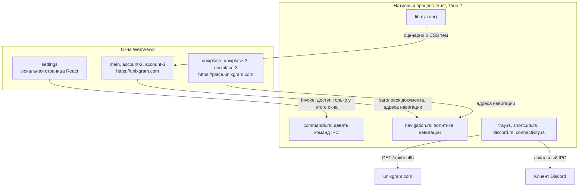
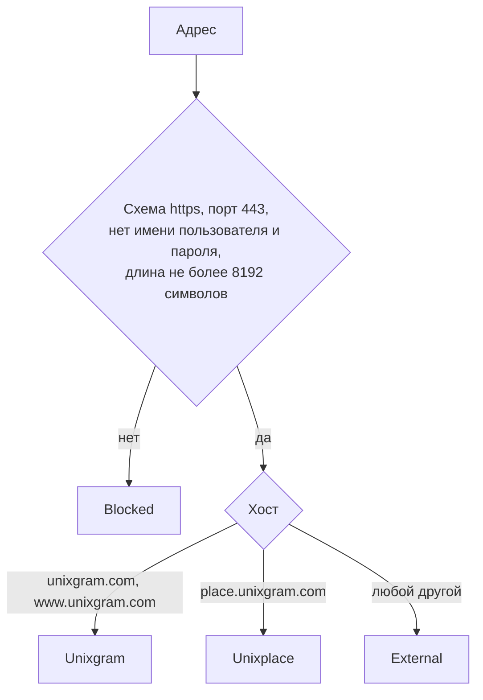
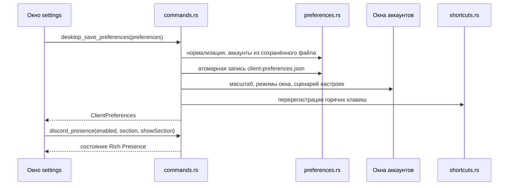

# Архитектура UnixGram Desktop

> [!NOTE]
> UnixGram Desktop — неофициальный клиент сообщества. Проект не связан с командой UnixGram и не одобрен ею.

## Содержание

- [Обзор](#обзор)
- [Процесс и окна](#процесс-и-окна)
- [Модули Rust](#модули-rust)
- [Контракт IPC](#контракт-ipc)
- [Политика навигации](#политика-навигации)
- [Внедряемые сценарии и нативная граница](#внедряемые-сценарии-и-нативная-граница)
- [Хранение настроек](#хранение-настроек)
- [Изоляция аккаунтов](#изоляция-аккаунтов)
- [Системные службы](#системные-службы)
- [Темы](#темы)
- [Интерфейс настроек](#интерфейс-настроек)
- [Тестирование](#тестирование)
- [Структура репозитория](#структура-репозитория)

## Обзор

Оболочка на Tauri 2 для Windows. Процесс на Rust открывает `https://unixgram.com` и торговую площадку `https://place.unixgram.com` в окнах WebView2 и добавляет значок в трее со счётчиком непрочитанных чатов, темы, до трёх аккаунтов, глобальные горячие клавиши, Discord Rich Presence, контроль соединения и политику навигации.

Свой интерфейс у приложения один: окно настроек, локальная страница на React из установщика. Вход, лента, сообщения, звонки, платежи и подарки выполняет код сайта внутри WebView2.

Основные решения:

- удалённые страницы не имеют доступа к IPC; команды вызывает только локальное окно настроек;
- из страницы в нативный код передаются только заголовок документа, адреса навигации и событие завершения загрузки файла;
- навигация ограничена точным списком доверенных хостов по HTTPS на порту 443;
- приложение не обрабатывает пароль аккаунта и не хранит сессию вне профилей WebView2;
- логика вынесена в чистые функции, которые проверяются модульными тестами без запуска окон.

## Процесс и окна

Нативный процесс один. Второй запуск показывает окно активного аккаунта (плагин `tauri-plugin-single-instance`).



### Окна

| Метка | Содержимое | Каталог данных WebView2 | Исходный размер | Закрытие |
| --- | --- | --- | --- | --- |
| `main` | `https://unixgram.com/dashboard`, аккаунт 1 | профиль по умолчанию | 1520 × 960 | скрывается в трей |
| `account-2`, `account-3` | `https://unixgram.com/dashboard`, аккаунты 2 и 3 | `account-profiles/account-N` | 1520 × 960 | скрывается в трей |
| `unixplace` | `https://place.unixgram.com`, аккаунт 1 | профиль по умолчанию | 1320 × 860 | скрывается, показывается окно аккаунта |
| `unixplace-2`, `unixplace-3` | `https://place.unixgram.com`, аккаунты 2 и 3 | `account-profiles/account-N` | 1320 × 860 | скрывается, показывается окно аккаунта |
| `settings` | `index.html` из состава приложения | профиль по умолчанию | 760 × 720 | закрывается |

Исходный размер уменьшается до рабочей области основного монитора с учётом масштаба Windows. Минимальный размер окна — 360 × 320.

Окна аккаунтов и UnixPlace получают строку User-Agent, совместимую с Microsoft Edge, с суффиксом `UnixGramHistory/<версия>`. В окнах аккаунтов отключён встроенный обработчик перетаскивания Tauri, чтобы перетаскивание файлов обрабатывал сайт.

### Запуск и завершение

Порядок запуска в `run()`:

1. Загружает и нормализует настройки.
2. Создаёт окно `main`. Оно видимо, если активен аккаунт 1.
3. Создаёт значок в трее и его меню.
4. Применяет настройки к окнам аккаунтов.
5. Регистрирует глобальные горячие клавиши, если они включены.
6. Запускает монитор соединения.
7. Показывает окно активного аккаунта, если активен аккаунт 2 или 3.
8. Запускает цикл обновления Discord Rich Presence.

Закрытие окна аккаунта скрывает его, процесс остаётся в трее. Завершает процесс пункт «Выйти» в меню трея.

## Модули Rust

Код оболочки лежит в `src-tauri/src/`.

| Модуль | Ответственность |
| --- | --- |
| `main.rs` | Точка входа. Вызывает `run()`. |
| `lib.rs` | Дерево модулей и функция `run()`: сборка приложения, плагины, `setup`, обработчики событий, `invoke_handler`. |
| `config.rs` | Константы: базовые адреса, доверенные хосты, User-Agent, идентификатор приложения Discord, адрес профиля автора, пределы (например, не более трёх аккаунтов). |
| `state.rs` | `AppState` и структуры состояния времени выполнения. |
| `preferences.rs` | Модель `ClientPreferences` и `AccountProfile`, загрузка, нормализация, атомарная запись. |
| `theme.rs` | Каталог тем и функция `theme_css`. Только чистые функции. |
| `navigation.rs` | `Destination`, `PromptGate`, проверка адресов, плагин политики навигации, подтверждение внешних ссылок, обработка всплывающих окон. |
| `accounts.rs` | Слоты аккаунтов, каталоги профилей WebView2, удаление записей связки ключей, оставшихся от старых версий. |
| `windows/` | Создание, показ, скрытие и размеры окон: `account.rs` — окна аккаунтов, `market.rs` — окна UnixPlace, `settings.rs` — окно настроек. `mod.rs` рассчитывает размеры, применяет настройки к окну и обрабатывает события окон. |
| `tray.rs` | Меню и события трея, подсчёт непрочитанных, отрисовка значка со счётчиком. |
| `discord.rs` | Discord Rich Presence. |
| `shortcuts.rs` | Глобальные горячие клавиши. |
| `connectivity.rs` | Монитор доступности сервиса и восстановление после обрыва. |
| `commands.rs` | Поверхность IPC: только тонкие функции с атрибутом `#[tauri::command]`. |
| `webview/` | JavaScript, внедряемый в страницы: `desktop-runtime.js` и `recovery.js` подключаются через `include_str!`; `mod.rs` формирует сценарий настроек. |

Правила размещения кода:

- команда в `commands.rs` проверяет аргументы и вызывает функции других модулей; собственной логики в ней нет;
- функции без побочных эффектов (классификация адресов, генерация CSS, нормализация настроек, расчёт размеров окна, разбор счётчика) отделены от кода, который работает с окнами и файлами;
- тесты находятся рядом с проверяемым кодом: в модулях `#[cfg(test)]` или в соседних файлах `*_tests.rs` и `tests.rs`.

## Контракт IPC

Окно настроек вызывает девять команд. Аргументы и результаты сериализуются в JSON с именами полей в camelCase. Ошибка возвращается строкой.

| Команда | Аргументы | Результат | Действие |
| --- | --- | --- | --- |
| `desktop_preferences` | — | `ClientPreferences` | Возвращает сохранённые настройки после нормализации. |
| `desktop_save_preferences` | `preferences` | `ClientPreferences` | Нормализует и сохраняет настройки, применяет их к окнам аккаунтов, перерегистрирует горячие клавиши. Список аккаунтов и активный аккаунт берутся из сохранённого файла, а не из аргумента. |
| `desktop_add_account` | `label` | `ClientPreferences` | Занимает свободный слот, очищает его, создаёт изолированный профиль и открывает окно нового аккаунта. |
| `desktop_switch_account` | `id` | `ClientPreferences` | Делает аккаунт активным и показывает его окно. |
| `desktop_remove_account` | `id` | `ClientPreferences` | Для аккаунтов 2 и 3 удаляет окно, профиль и запись в настройках. Для аккаунта 1 сбрасывает вход. |
| `desktop_open_creator_profile` | — | — | Открывает профиль автора проекта в окне активного аккаунта. Адрес задан константой. |
| `desktop_media_settings` | `device` | — | Открывает раздел параметров Windows. Допустимые значения: `microphone`, `camera`, `sound`. |
| `desktop_security_status` | — | `SecurityStatus` | Возвращает сведения для раздела «Центр безопасности». |
| `discord_presence` | `enabled`, `section`, `showSection` | строка | Включает, обновляет или выключает Rich Presence. Идентификатор приложения Discord задан константой в `config.rs`. |

Типы на стороне интерфейса объявлены в `src/shared/ipc/` и повторяют структуры Rust:

- `ClientPreferences` (на стороне интерфейса — `Preferences`) — поля перечислены в разделе [Хранение настроек](#хранение-настроек);
- `AccountProfile` — `id` (1–3) и `label` (до 32 символов);
- `SecurityStatus` — `httpsOnly`, `trustedHosts`, `sessionStorage`, `isolatedAccounts`, `maxAccounts`, `online`, `notificationsPrivate`, `discordPrivate`, `globalHotkeys`, `registeredHotkeys`, `expectedHotkeys`, `unavailableHotkeys`, `version`.

Поле `SecurityStatus.sessionStorage` содержит строку «изолированные профили WebView2».

### Ограничение доступа

Доступ к IPC ограничен списком управления доступом Tauri. Его задают два файла:

- `src-tauri/build.rs` объявляет девять команд в манифесте приложения. После этого команды приложения запрещены по умолчанию, а для каждой из них создаются разрешения `allow-<команда>` и `deny-<команда>`.
- `src-tauri/capabilities/settings.json` — единственная capability приложения. Она относится к одному окну, `settings`, и выдаёт ему набор `core:default` и девять разрешений `allow-*`.

Секции `remote` в capability нет, поэтому страницы, загруженные с `unixgram.com` и `place.unixgram.com`, не получают доступа к `invoke`. Окна аккаунтов и UnixPlace не указаны ни в одной capability.

Список команд должен совпадать в трёх местах: `invoke_handler` в `lib.rs`, `build.rs` и `capabilities/settings.json`.

Страница настроек работает под политикой Content Security Policy из `src-tauri/tauri.conf.json`: `default-src 'self'`, `connect-src 'self'`, `frame-src 'none'`, `object-src 'none'`, шрифты только из состава приложения (`font-src 'self' data:`). Сетевых запросов за шрифтами страница не выполняет.

## Политика навигации

Каждый адрес классифицирует функция `destination` из `navigation.rs`. Результат — одно из четырёх значений перечисления `Destination`.



Хост сравнивается точно. Поддомены и похожие имена, например `unixgram.com.example.com`, относятся к `External`.

Плагин `unixgram-navigation` перехватывает каждую навигацию в окнах аккаунтов и UnixPlace и принимает решение по таблице.

| Класс адреса | Окно аккаунта | Окно UnixPlace |
| --- | --- | --- |
| `Unixgram` | Разрешить. | Отменить; открыть адрес в окне аккаунта того же слота. |
| `Unixplace` | Отменить; открыть адрес в окне UnixPlace того же слота. | Разрешить. |
| `External` | Отменить; запросить подтверждение. | Отменить; запросить подтверждение. |
| `Blocked` | Отменить. | Отменить. |

### Внешние ссылки

Внешняя ссылка никогда не открывается внутри приложения. Порядок обработки:

1. Запрос игнорируется, если окно-источник не в фокусе. Фоновая страница не может вывести диалог поверх активного приложения.
2. `PromptGate` допускает один диалог одновременно и не показывает следующий раньше чем через 15 секунд после закрытия предыдущего. Запросы не ставятся в очередь.
3. В диалоге показывается только источник ссылки (схема и хост). Путь и параметры не выводятся, так как ссылки ботов могут содержать служебные данные.
4. После подтверждения адрес открывается в системном браузере.

### Всплывающие окна

Создание новых окон по запросу страницы запрещено всегда. Обработчик `on_new_window` возвращает отказ и поступает с адресом так:

- `Unixgram` и `Unixplace` — выполняет переход в окне-источнике; дальше действует политика навигации;
- `External` — запрашивает подтверждение, как для обычной внешней ссылки;
- `Blocked` — ничего не делает.

## Внедряемые сценарии и нативная граница

В страницы сайта внедряются три сценария, все только в окне верхнего уровня.

| Сценарий | Где и когда выполняется | Назначение |
| --- | --- | --- |
| `webview/desktop-runtime.js` | Сценарий инициализации окон аккаунтов; выполняется при каждой загрузке страницы. Работает только на `https://unixgram.com` и `https://www.unixgram.com`. | Счётчик непрочитанных чатов и уведомление о восстановлении связи. |
| Сценарий настроек, формируется функцией `preferences_script` в `webview/mod.rs` | Окна аккаунтов; после загрузки страницы и после сохранения настроек. | Передаёт параметры в `desktop-runtime.js`, устанавливает атрибут `data-theme`, вставляет CSS темы. |
| `webview/recovery.js` | Окна аккаунтов и UnixPlace; при восстановлении соединения. | Показывает уведомление о восстановлении связи. Страницу не перезагружает. |

### Счётчик непрочитанных

`desktop-runtime.js` запрашивает `GET /api/social/messages/unread-count` тем же способом, что и сайт: запрос идёт из страницы, с cookie того же источника. Правила:

- запрос выполняется только на страницах аккаунта (`/dashboard`, `/u/`, `/post/`, `/communities`), при наличии сети и если включён счётчик в трее или уведомления Windows;
- интервал — 30 секунд для видимой страницы и 60 секунд для скрытой; время ожидания ответа — 8 секунд;
- принимается только ответ с `success: true` и неотрицательным целым в `data.unreadChats` (допускаются `data.count` и `data.unreadCount`); значение ограничивается числом 999;
- ответ неизвестной формы и сетевая ошибка не изменяют счётчик; ошибка не превращается в ноль;
- после ответа 401 опрос приостанавливается на 120 секунд, после 429 соблюдается `Retry-After` (не менее 30 секунд).

Результат сценарий записывает в заголовок документа в виде префикса `(N)`. Нативный код читает только этот префикс.

Это единственный дополнительный запрос с данными аккаунта, который выполняется по инициативе приложения. Остальные обращения к API сервиса — авторизация, WebSocket, клавиатуры ботов, счета, подарки, баланс, вложения и звонки — выполняет код сайта; приложение их не заменяет, не повторяет платежи и не определяет владение подарками или состояние баланса по содержимому страницы.

Поле `data.unreadChats` проверено на сайте с выполненным входом 11 октября 2026 года; `data.count` и `data.unreadCount` сохранены как совместимые варианты. Описание интерфейсов сервиса, по которому сверялся контракт (просмотрено 11 октября 2026 года):

- <https://web.unixgram.com/api/client/>
- <https://web.unixgram.com/api/realtime/>
- <https://web.unixgram.com/api/methods/>
- <https://web.unixgram.com/api/bots/>

### Восстановление связи

При событии `online` или после возврата к странице, которая была скрыта дольше минуты, сценарий показывает уведомление с кнопкой «Обновить». Перезагрузка выполняется только после подтверждения пользователя. Автоматической перезагрузки нет: звонок, незавершённая отправка и несохранённый текст не прерываются.

### Сценарий настроек

При применении настроек сценарий:

- вызывает `window.__ugdRuntime.configure` с тремя логическими параметрами: `reconnectEnabled`, `trayUnreadBadge`, `windowsNotifications`;
- для тем, отличных от `native`, удерживает атрибут `data-theme` корневого элемента в значении `light` или `dark`; для темы `native` возвращает исходное значение сайта;
- записывает результат `theme_css` в элемент `<style id="unixgram-desktop-preferences">`;
- устанавливает атрибут `data-ugd-page` (`messages` или `default`), на который опираются правила для чатов;
- на страницах вне `/dashboard` нажимает видимую кнопку сайта, которая сообщает об истёкшем QR-коде и предлагает обновить его, не чаще одного раза в 10 секунд.

### Что пересекает границу

| Направление | Данные | Обработка |
| --- | --- | --- |
| Страница → нативный код | Заголовок документа | Обрезается до 512 символов. Из него извлекается только префикс `(N)`; значение ограничивается числом 999. |
| Страница → нативный код | Адрес навигации или всплывающего окна | Классифицируется функцией `destination`. Путь адресов `unixgram.com` используется для определения названия раздела. |
| Страница → нативный код | Завершение загрузки файла | Используется только признак успеха для уведомления Windows. |
| Нативный код → страница | Масштаб, полноэкранный режим, режим «поверх окон» | Устанавливаются через API окна. |
| Нативный код → страница | CSS темы и три логических параметра | Передаются сценарием настроек. |

Учётные данные, cookie, тексты сообщений и тела ответов сервера в нативный код не передаются. Вызовов `invoke` из страниц сайта нет.

## Хранение настроек

Настройки лежат в `client-preferences.json` в каталоге конфигурации приложения (`%APPDATA%\com.unixgram.desktop.community`). Это JSON с полями в camelCase.

| Поле | Тип | По умолчанию | Ограничение |
| --- | --- | --- | --- |
| `theme` | строка | `native` | Один из 13 идентификаторов тем; иначе `native`. |
| `liquidGlass` | логический | `false` | — |
| `glassStrength` | число | `0.72` | От 0.58 до 0.90. |
| `glassMode` | строка | `frosted` | `frosted` или `clear`. |
| `reduceTransparency` | логический | `false` | — |
| `compactChats` | логический | `false` | — |
| `largeChatText` | логический | `false` | — |
| `reduceMotion` | логический | `false` | — |
| `smoothScroll` | логический | `false` | — |
| `underlineLinks` | логический | `false` | — |
| `fullscreen` | логический | `false` | — |
| `alwaysOnTop` | логический | `false` | — |
| `zoom` | число | `1.0` | От 0.8 до 1.4. |
| `discordPresence` | логический | `true` | — |
| `discordShowSection` | логический | `false` | — |
| `trayUnreadBadge` | логический | `true` | — |
| `windowsNotifications` | логический | `true` | — |
| `reconnectEnabled` | логический | `true` | — |
| `globalHotkeys` | логический | `true` | — |
| `activeAccount` | целое | `1` | Должен существовать в `accounts`; иначе `1`. |
| `accounts` | массив `AccountProfile` | один аккаунт «Основной» | Идентификаторы 1–3 без повторов; аккаунт 1 присутствует всегда. |

Правила работы с файлом:

- Загрузка: отсутствующий или повреждённый файл заменяется значениями по умолчанию. Отсутствующие поля получают значения по умолчанию, поэтому файл старой версии остаётся совместимым.
- Нормализация выполняется при каждой загрузке и при сохранении настроек из окна настроек. Названия аккаунтов обрезаются до 32 символов, управляющие символы удаляются; пустое название заменяется на «Аккаунт N».
- Запись атомарная: данные записываются во временный файл `client-preferences.json.tmp`, затем файл переименовывается.

Пароли, cookie и токены в файл настроек не записываются.



## Изоляция аккаунтов

Аккаунтов до трёх. Каждый занимает слот с идентификатором 1, 2 или 3.

| Слот | Окно аккаунта | Окно UnixPlace | Каталог данных WebView2 |
| --- | --- | --- | --- |
| 1 | `main` | `unixplace` | профиль WebView2 по умолчанию |
| 2 | `account-2` | `unixplace-2` | `%APPDATA%\com.unixgram.desktop.community\account-profiles\account-2` |
| 3 | `account-3` | `unixplace-3` | `%APPDATA%\com.unixgram.desktop.community\account-profiles\account-3` |

Окно аккаунта и окно UnixPlace одного слота используют общий каталог данных, поэтому вход на площадке соответствует аккаунту. Слоты между собой данные не разделяют: cookie, локальное хранилище и кэш у каждого слота свои.

Жизненный цикл слота:

- Добавление: выбирается наименьший свободный идентификатор. Перед использованием слот очищается: закрываются его окна, удаляются данные просмотра и каталог профиля, оставшиеся от прежнего аккаунта. Затем создаётся окно, и пользователь входит на сайте UnixGram.
- Переключение: все окна аккаунтов скрываются, окно выбранного аккаунта показывается. Одновременно видимо одно окно аккаунта.
- Удаление аккаунта 2 или 3: окна слота уничтожаются, каталог профиля переименовывается и удаляется в фоновом потоке, запись исключается из настроек. Если WebView2 ещё удерживает каталог, команда возвращает ошибку и предлагает повторить действие.
- Сброс аккаунта 1: данные просмотра окон `main` и `unixplace` удаляются, окно `main` переходит на страницу входа. Слот 1 не удаляется.

### Сессии и связка ключей

Сессия аккаунта существует только в профиле WebView2: её создаёт и обновляет сайт UnixGram. Приложение не получает пароль аккаунта и не записывает сессию в Диспетчер учётных данных Windows.

Ранние версии приложения могли оставить в Диспетчере учётных данных записи службы `com.unixgram.desktop.community`. Библиотека `keyring` используется только для удаления такой записи при сбросе, добавлении или удалении соответствующего слота.

## Системные службы

### Трей и уведомления

Значок в трее имеет меню: «Открыть UnixGram», «Лента», «Сообщения», «UnixPlace», «Настройки клиента», «Выйти». Двойной щелчок левой кнопкой показывает окно активного аккаунта.

Счётчик непрочитанных формируется так:

1. Изменение заголовка окна аккаунта обрабатывается с задержкой 250 миллисекунд, чтобы учитывать только последнее значение.
2. Из заголовка извлекается префикс `(N)`.
3. Значения всех окон аккаунтов суммируются; сумма ограничивается числом 999.
4. Если счётчик включён, на значке рисуется красный круг с числом (не более 99).

Уведомления Windows не содержат текста сообщений и имён. Приложение отправляет три вида уведомлений: число непрочитанных чатов (если оно выросло, а окно не в фокусе), результат загрузки файла и восстановление соединения.

### Монитор соединения

`connectivity.rs` запрашивает `GET https://unixgram.com/api/health` каждые 15 секунд и считает сервис доступным, если получен успешный ответ с `"ok": true`. Запрос выполняется без cookie. При недоступности интервал растёт от 10 до 40 секунд. Состояние отображается в подсказке значка в трее и в разделе «Центр безопасности».

При восстановлении соединения, если включён параметр «Переподключаться при обрыве», в окнах аккаунтов и UnixPlace выполняется `webview/recovery.js`.

### Discord Rich Presence

`discord.rs` подключается к запущенному клиенту Discord по локальному IPC. Передаются название приложения и, если включён параметр «Показывать раздел», общее название раздела: «Лента», «Сообщения», «Профиль», «Боты», «Уведомления», «Сообщества», «Студия», «Подарки», «Поиск», «Звёзды», «UnixPlace» или «Настройки». Название определяется по пути адреса в нативном коде. Имена пользователей, адреса и содержимое страниц не передаются. Состояние обновляется каждые 15 секунд; при недоступности Discord попытка повторяется.

### Горячие клавиши

`shortcuts.rs` регистрирует восемь глобальных сочетаний.

| Действие | Основное сочетание | Дополнительное сочетание |
| --- | --- | --- |
| Открыть UnixGram | `Ctrl+Shift+1` | `Ctrl+Alt+U` |
| Сообщения | `Ctrl+Shift+2` | `Ctrl+Alt+M` |
| UnixPlace | `Ctrl+Shift+3` | `Ctrl+Alt+G` |
| Настройки | `Ctrl+Shift+4` | `Ctrl+Alt+S` |

Сочетание, занятое другой программой, пропускается и не мешает запуску. Число зарегистрированных сочетаний и список занятых возвращает команда `desktop_security_status`.

## Темы

Каталог содержит 13 тем. Функция `theme_css` из `theme.rs` по настройкам формирует CSS, который вставляется в страницы сайта. Каталог для окна настроек находится в `src/shared/theme/themes.ts`; идентификаторы в обоих каталогах совпадают.

| Идентификатор | Название | Фон | Панель | Акцент | Текст |
| --- | --- | --- | --- | --- | --- |
| `native` | UnixGram | цвета сайта | цвета сайта | `#6e5fe4` | цвета сайта |
| `midnight` | Midnight | `#0a0e1a` | `#151d30` | `#a097ff` | `#edf0ff` |
| `oled` | OLED | `#000000` | `#0b0b0e` | `#a397ff` | `#ffffff` |
| `graphite` | Graphite | `#121416` | `#202328` | `#b3bdce` | `#f4f5f7` |
| `aurora` | Aurora | `#091612` | `#142820` | `#71dab5` | `#effffb` |
| `light` | Daylight | `#f1f2f5` | `#ffffff` | `#5948c7` | `#191b24` |
| `lucifer` | Lucifer | `#10080b` | `#241018` | `#e78a9d` | `#fff1f3` |
| `basaltes` | by basaltes | `#08050e` | `#191023` | `#bb97ff` | `#f7efff` |
| `honey` | Soft Honey | `#15120b` | `#272115` | `#dfc171` | `#fff8e6` |
| `ocean` | Ocean | `#08131c` | `#112635` | `#79c8ec` | `#ecf8ff` |
| `rose` | Rose | `#180f17` | `#2c1c29` | `#e9a4c2` | `#fff1f8` |
| `forest` | Forest | `#11160f` | `#212b1b` | `#b7cc8c` | `#f1f7e9` |
| `mexican-pink` | Mexican Pink | `#140911` | `#28121f` | `#e4007c` | `#fff3f9` |

Свойства генерируемого CSS:

- тема `native` не переопределяет цвета сайта; остальные темы задают переменные `--ugd-*` и переопределяют переменные сайта;
- режим Liquid Glass применяет размытие только к шапке, боковым панелям, навигации и диалогам; публикации, фотографии и видео не размываются;
- параметр «Без прозрачности» и системные настройки `prefers-reduced-transparency` и `forced-colors` отключают размытие и возвращают плотные панели;
- параметр «Меньше анимаций» и системная настройка `prefers-reduced-motion` отключают анимации и плавную прокрутку;
- собственные цвета кнопок сайта, включая кнопки ботов, сохраняются.

## Интерфейс настроек

Окно `settings` загружает `index.html` без параметров запроса. Точка входа `src/main.tsx` всегда отображает приложение настроек.

| Путь | Содержимое |
| --- | --- |
| `src/main.tsx` | Точка входа. |
| `src/app/SettingsApp.tsx` | Корневая композиция: шапка, разделы, подвал. |
| `src/features/settings/sections/` | По одному компоненту на раздел: аккаунты, оформление, чаты, окно, система, горячие клавиши, Discord, устройства, безопасность. |
| `src/features/settings/components/` | Переиспользуемые элементы: карточка раздела с заголовком, переключатель, строка с ползунком, кнопка «Применить». |
| `src/features/settings/hooks/` | Состояние и побочные эффекты: загрузка и сохранение настроек, действия с аккаунтами, действия оболочки (параметры устройств Windows, профиль автора), палитра выбранной темы, прокрутка с клавиатуры, состояние безопасности. |
| `src/shared/ipc/` | Типизированные обёртки над `invoke` для девяти команд и типы `Preferences`, `AccountProfile`, `SecurityStatus`. |
| `src/shared/theme/themes.ts` | Каталог тем: `themes` (идентификатор, название, цвет акцента, примечание) и `surfaces` (фон, панель и текст каждой темы). |
| `src/styles/` | Базовая таблица стилей и таблица стилей настроек. |

Правила:

- компоненты не вызывают `invoke` напрямую; обращение к нативному коду идёт через `src/shared/ipc/`;
- изменения в форме применяются только после нажатия «Применить»; до этого страница показывает предварительный вид выбранной темы;
- вне оболочки Tauri, например в браузере при `npm run dev`, страница работает в режиме предпросмотра: команды недоступны, кнопки сохранения и действий с аккаунтами отключены. В этом режиме страницу открывают тесты Playwright.

## Тестирование

| Уровень | Что проверяется | Команда |
| --- | --- | --- |
| Модульные тесты Rust | Классификация адресов и `PromptGate`, генерация CSS тем, нормализация настроек, расчёт размеров окна, формирование данных Discord, разбор счётчика из заголовка. | `npm run tauri:test:windows` |
| Тесты Playwright | Страница настроек в режиме предпросмотра и внедряемый сценарий `desktop-runtime.js` на подставной странице. | `npm run test:e2e` |
| Совместимость тем | CSS, сформированный кодом Rust, применяется к подставной разметке сайта. | `npm run test:native-e2e` |

Спецификации Playwright находятся в `tests/e2e/` и открывают страницу настроек по адресу `/`.

| Файл | Назначение |
| --- | --- |
| `settings.spec.ts` | Сценарии страницы настроек. |
| `responsive-settings.spec.ts` | Работоспособность настроек при размерах окна от 360 × 480 до 2560 × 1440. |
| `settings-palette.spec.ts` | Контрастность элементов управления не ниже 4,5:1 во всех 13 темах. |
| `desktop-runtime.spec.ts` | Счётчик непрочитанных, обработка ответов 401 и 429, уведомление о восстановлении связи без перезагрузки. |
| `bot-theme-compatibility.spec.ts` | Сохранение цветов и размеров кнопок сайта под каждой темой. |

Спецификация `bot-theme-compatibility.spec.ts` читает файл `diagnostics/native-theme-fixtures.json`. Его создаёт тест Rust: 13 тем × 2 варианта плотности чатов × 4 режима стекла, всего 104 набора CSS. Каталог `diagnostics/` не хранится в репозитории, поэтому команда `npm run test:native-e2e` сначала запускает тесты Rust.

Статические проверки: `npm run lint` (oxlint), `npm run typecheck` (TypeScript), `npm run tauri:check:windows` (`cargo fmt --check` и `cargo clippy -D warnings`).

В GitHub Actions workflow `release-quality.yml` выполняет три задания: `web` (lint, typecheck, сборка, Playwright, `npm audit`), `rust` (`cargo fmt --check`, `cargo clippy`, `cargo test` на Windows) и `security` (Gitleaks и Trivy).

### Границы автоматической проверки

Автоматические тесты не обращаются к сервису UnixGram и не используют реальный аккаунт. Они проверяют поведение оболочки и CSS, сформированный нативным кодом, на подставных страницах. Они не подтверждают вход, продление сессии сайтом, доставку сообщений, звонки между устройствами, покупки, счета ботов, показ уведомлений Windows и отображение статуса в Discord в установленном приложении. Эти сценарии проверяются вручную по [чек-листу выпуска](RELEASE-CHECKLIST.md). Финансовые операции в качестве проверочных не выполняются.

## Структура репозитория

```text
UnixGramDesktop/
├── src/                     интерфейс окна настроек (React, TypeScript)
│   ├── app/                 корневая композиция
│   ├── features/settings/   разделы, компоненты и хуки настроек
│   ├── shared/              обёртки IPC и каталог тем
│   └── styles/              таблицы стилей
├── src-tauri/               оболочка Tauri и код Rust
│   ├── capabilities/        разрешения IPC для окна настроек
│   ├── icons/               значки приложения
│   ├── installer/           оформление установщика NSIS
│   ├── src/                 модули Rust
│   │   └── webview/         сценарии, внедряемые в страницы
│   ├── build.rs             объявление команд IPC для списка доступа
│   ├── Cargo.toml           зависимости Rust
│   └── tauri.conf.json      конфигурация приложения и установщика
├── tests/e2e/               спецификации Playwright
├── public/                  статические ресурсы Vite
├── scripts/                 сценарии сборки и проверки для Windows
├── docs/                    документация, заметки о выпусках, изображения
├── artifacts/               локальные результаты, не хранятся в Git
├── .github/                 workflow, шаблоны и настройки Dependabot
├── CHANGELOG.md             история изменений
├── package.json             сценарии npm и зависимости интерфейса
└── README.md                описание проекта
```

Установщик после сборки находится в `src-tauri/target/release/bundle/nsis`.
