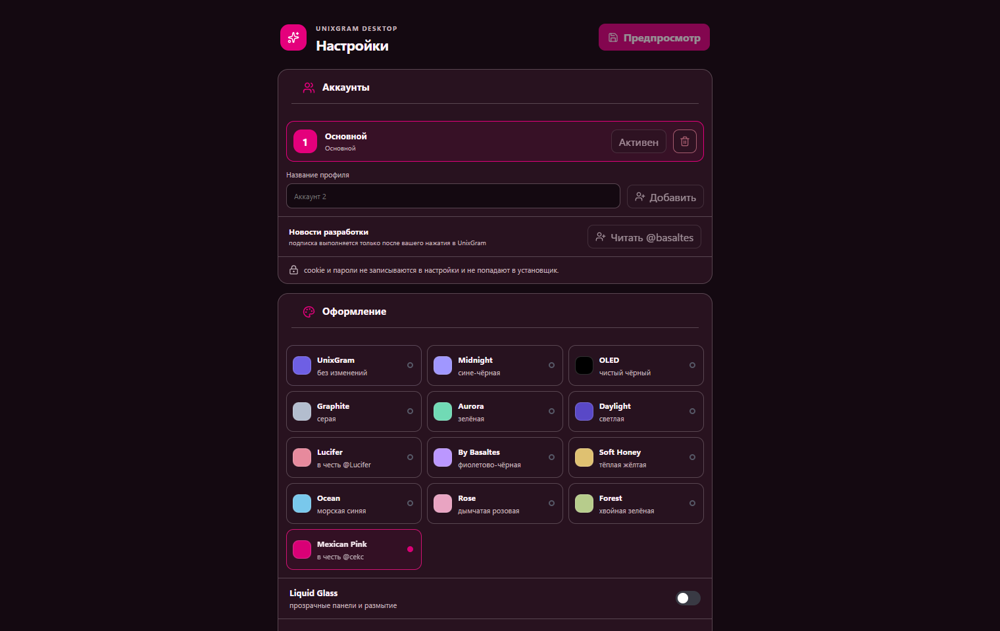

# UnixGram Desktop 1.3.4

Дата выпуска: 16 октября 2026 года.

Выпуск добавляет тему Mexican Pink. Остальные изменения совпадают с версией [1.3.3](v1.3.3.md), выпущенной в тот же день.

## Добавлено

- Тема Mexican Pink в честь пользователя UnixGram `@cekc`: розовый акцент `#E4007C`, тёмные сливовые панели и светлый текст. Тема доступна всем пользователям в разделе настроек «Оформление».
- Тема работает с матовым и прозрачным стеклом, с отключённой прозрачностью и с компактными чатами. Цвета кнопок ботов сохраняются.

## Изменения версии 1.3.3 в составе выпуска

- Исправлены цвета темы Daylight и стандартной темы со стеклом.
- Кнопки и переключатели настроек используют выбранную палитру.
- Счётчик непрочитанных чатов получает данные с сервера.
- После восстановления связи страница не перезагружается автоматически.
- Исправлены названия разделов в Discord и повторные нажатия в форме аккаунтов.

## Установка

Файл установщика: `UnixGram-Desktop-1.3.4-x64-setup.exe`. Контрольная сумма приложена к выпуску в файле `SHA256SUMS.txt`.

Установщик не подписан сертификатом Authenticode. Windows может показать неизвестного издателя. Отключать защиту системы не требуется.

Пошаговая инструкция: [INSTALL-WINDOWS.md](../INSTALL-WINDOWS.md).

## Проверки

Проверены сборка, тесты Rust, браузерные проверки настроек и CSS тем. Эти проверки не подтверждают доставку уведомлений Windows, отображение статуса Discord и переключение реальных аккаунтов в установленном приложении.

## Ссылки

- [Страница выпуска](https://github.com/jutsu-dev/UnixGramDesktop/releases/tag/v1.3.4)
- [Сообщить о проблеме](https://github.com/jutsu-dev/UnixGramDesktop/issues/new/choose)
- [Новости проекта](https://t.me/unixgramhistory)

UnixGram Desktop — независимый проект сообщества UnixGram History с открытым исходным кодом. Это неофициальный клиент; проект не связан с командой UnixGram.
